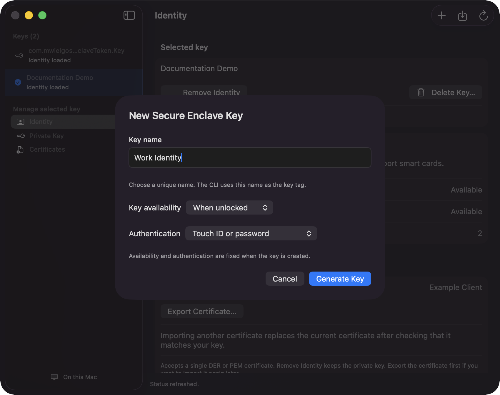
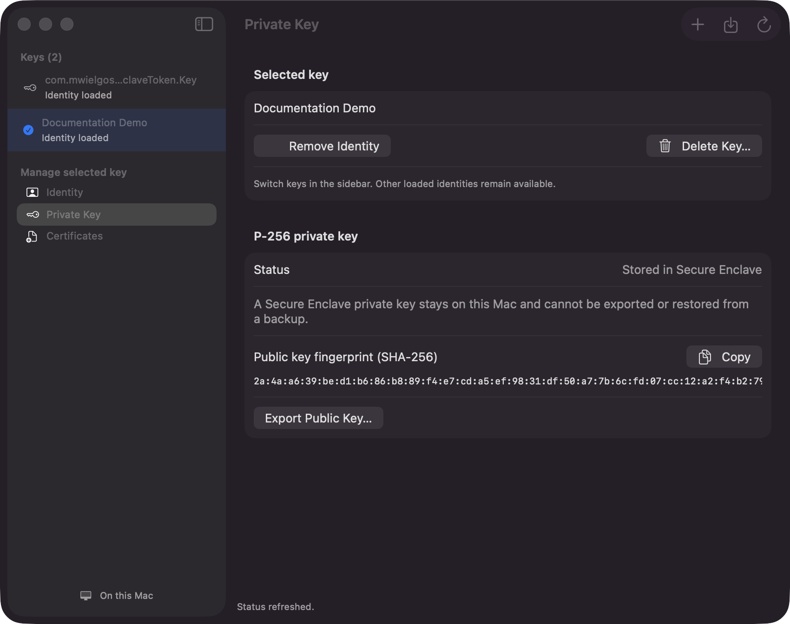
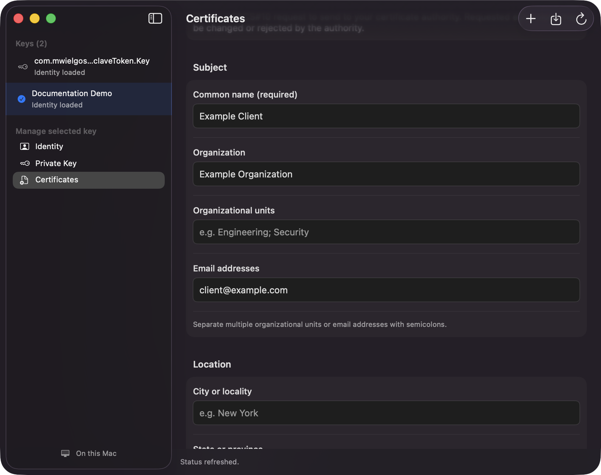
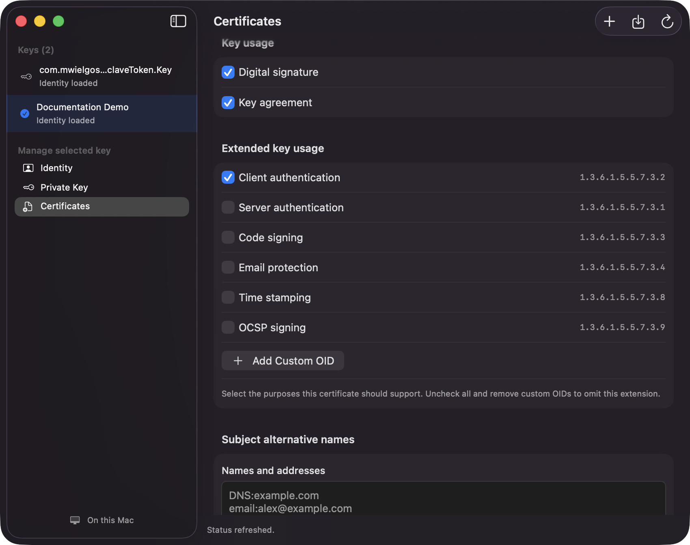
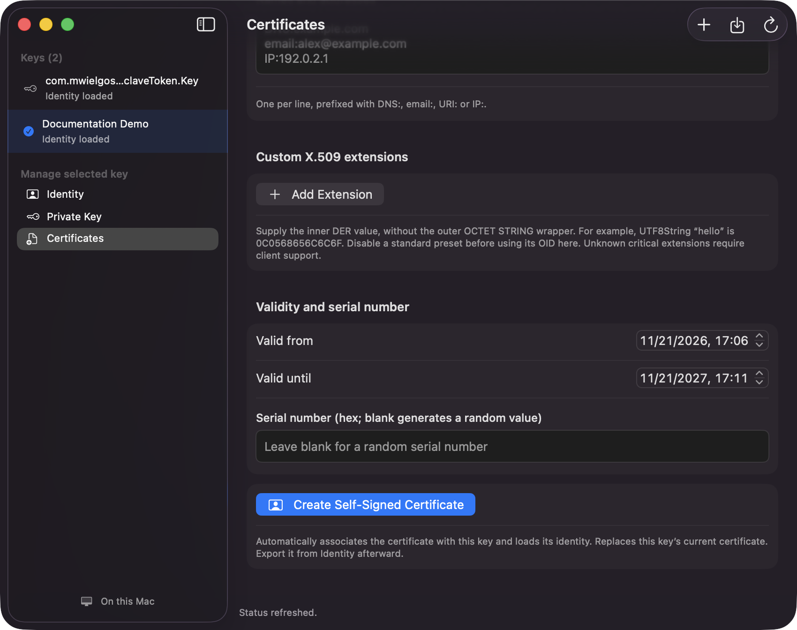
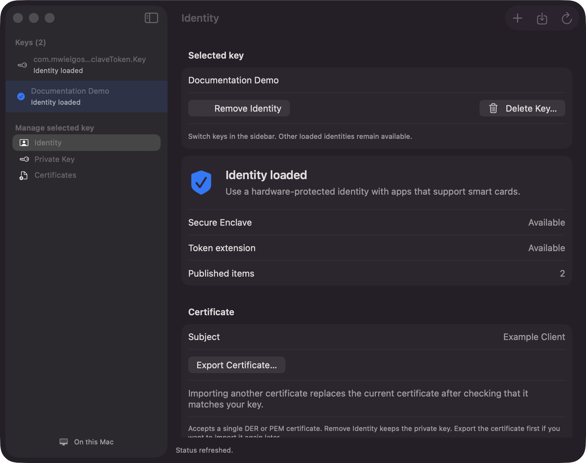
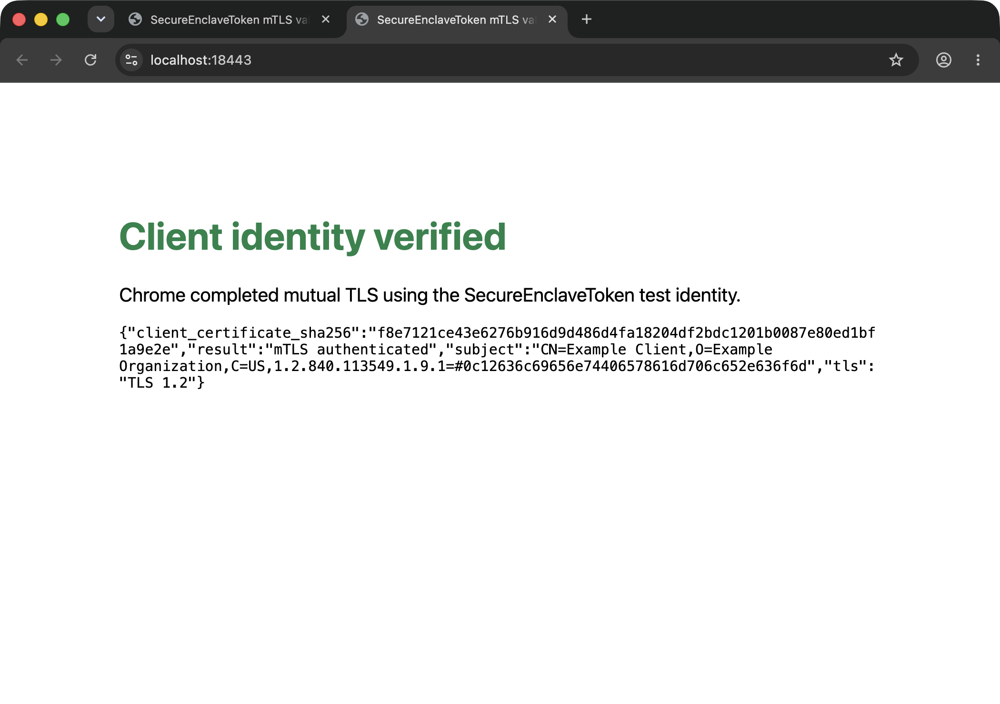

# SecureEnclaveToken

Create P-256 keys in your Mac’s Secure Enclave and use them as CryptoTokenKit
identities for client certificates, SSH, signing, and ECDH key exchange. Private
keys stay on the Mac and cannot be exported or restored from a backup.

Requires **Apple Silicon and macOS Tahoe 26.0 or later**. Multiple keys and
identities can be loaded at the same time.

## Getting started

Build and run a signed copy of the app using the [build instructions](#building).
The app and extension must use the same signing team and keychain access group.

### 1. Create a key

Click **Add Key** (`+`) in the upper-right toolbar. Enter a unique name, choose
when the key is available and how it authenticates, then click **Generate Key**.
The defaults require an unlocked Mac and Touch ID or your password.



These policies are fixed at creation. The key name is also the tag used by the
CLI. Select a key in the sidebar to manage it; switching keys leaves other
loaded identities available.

### 2. Inspect the public key

Open **Private Key** to see its Secure Enclave status and SHA-256 public-key
fingerprint. **Copy** copies the entire fingerprint; **Export Public Key…**
saves DER SubjectPublicKeyInfo.



### 3. Enter the certificate subject

Open **Certificates** and choose **Signing request** or **Self-signed
certificate**. Enter a **Common name**, such as your name or a hostname.
Organization, locality, and country are optional. Country accepts a two-letter
code, such as `US`. Use semicolons for multiple email addresses or organizational
units.



If an input is invalid, the form explains what needs correcting. **Enter Common
Name** takes you to the required field when it is empty.

### 4. Choose usages and extensions

Check the extended key usages your client needs. **Client authentication** is
selected by default. **Add Custom OID** adds another extended key usage;
**Add Extension** adds a complete custom X.509 extension.



| Input | Format |
| --- | --- |
| Subject alternative names | One per line: `DNS:example.com`, `email:me@example.com`, `URI:https://example.com`, or `IP:192.0.2.1` |
| Additional subject attribute | OID plus UTF-8, PrintableString, IA5String, or DER value |
| Custom extended key usage | One dotted-decimal OID per entry |
| Custom X.509 extension | OID, critical flag, and the inner DER value in hexadecimal |

For example, `1.3.6.1.4.1.55555.1` with value `0C0568656C6C6F` encodes the
UTF8String `hello`. Do not include the extension’s outer OCTET STRING wrapper.
Disable a standard preset before supplying its OID as a custom extension.
Unknown critical extensions must be supported by the relying client.

### 5. Create or import a certificate

For a **signing request**, click **Save Signing Request…**, send the `.csr` to
your certificate authority, and use the toolbar’s **Import Certificate** button
to load the returned certificate. Import accepts a single PEM or DER certificate
and verifies that it matches the selected key.

For a **self-signed certificate**, set the validity dates and optionally a
hexadecimal serial number, then click **Create Self-Signed Certificate**. The
app automatically associates it with the selected key and loads the identity.



Self-signed certificates default to `CA=false`. Creating or importing a
certificate does not change system trust settings. Each relying application or
server decides whether to accept it.

### 6. Manage the identity

**Identity** shows the loaded certificate. Use **Export Certificate…** to save
it as PEM. Creating or importing another certificate replaces the selected
key’s certificate without changing other identities.



- **Remove Identity** removes the published certificate and identity, keeping
  the private key. Export the certificate first if you want to reload it later.
- **Delete Key…** permanently deletes the selected key and unloads its identity,
  after a confirmation naming the key.
- The toolbar buttons provide **Add Key**, **Import Certificate**, and
  **Refresh**. Hover over them for descriptions.
- The menu bar key icon can reopen the window, refresh status, remove the
  selected identity, or quit. Closing the window leaves the menu bar item
  running; quitting does not remove published identities.

## SSH

Load an identity in the app, using a self-signed or CA-issued certificate. Use
Apple’s `/usr/bin/ssh` tools and `/usr/lib/ssh-keychain.dylib` to access it.

Export resident-key references into a new, empty directory:

```sh
mkdir -p ~/.ssh/secure-enclave-token
cd ~/.ssh/secure-enclave-token
SSH_ASKPASS_REQUIRE=force SSH_ASKPASS=/usr/bin/true \
  /usr/bin/ssh-keygen -w /usr/lib/ssh-keychain.dylib -K
```

The generated `id_ecdsa_sk_rk` is a reference to the key, not exported private-key
material. Add `id_ecdsa_sk_rk.pub` to your GitHub account’s SSH authentication keys,
or to the remote account’s `authorized_keys` for another server.

Add this entry to `~/.ssh/config`:

```sshconfig
Host github.com
  IdentityFile ~/.ssh/secure-enclave-token/id_ecdsa_sk_rk
  SecurityKeyProvider /usr/lib/ssh-keychain.dylib
  User git
  IdentitiesOnly yes
```

Then test authentication:

```sh
/usr/bin/ssh -T git@github.com
```

GitHub reports successful authentication without providing a shell. Keep the
identity loaded in SecureEnclaveToken. The remote service must accept
`sk-ecdsa-sha2-nistp256@openssh.com` keys.

When exporting multiple identities, use `KEYCHAIN_CERTIFICATES=HASH` to select
one. Obtain that hexadecimal SHA-1 identifier from `sc_auth identities` or
`security export-smartcard`; it differs from the app’s SHA-256 fingerprint and
SSH’s fingerprint. See `man ssh-keychain` for filtering. Use separate directories
if exports would otherwise reuse a filename.

Local resident-key export and SSH-format signing/verification have been tested.
Authentication to your GitHub account or another remote server requires adding
the public key there and running the connection test above.

## Chrome and mutual TLS

Chrome can use a loaded SecureEnclaveToken identity for mTLS:

1. Create a signing request with **Digital signature** and **Client
   authentication** selected.
2. Have it signed by a CA accepted by the server, then import the certificate.
3. Open the HTTPS service in Chrome and select the matching client certificate
   when prompted. Authenticate with macOS if the key’s policy requires it.

The server must request a client certificate and accept its issuer. A self-signed
certificate works only if the server is configured to accept it. A server’s TLS
certificate must also be trusted by the browser; client identity loading does
not establish server trust. Chromium filters client certificates by validity,
key usage, EKU, and the server’s acceptable issuers.
([Chromium implementation](https://chromium.googlesource.com/chromium/src/+/main/net/ssl/client_cert_store_mac.cc))



**Verified on macOS 26.4.1 with Chrome 158.0.8127.36:** a CA-issued P-256 identity
completed mTLS over TLS 1.2 and TLS 1.3. The local server verified the exact client
certificate and rejected a connection without a client certificate. The test
key used no additional authentication; Touch ID prompt behavior was not part of
this browser test. See [the test record and reproduction steps](docs/mtls-testing.md).

## Command line

### Install `setoken`

Run the installer from your signed app’s actual location:

```sh
"/Applications/SecureEnclaveToken.app/Contents/Resources/install-setoken"
export PATH="$HOME/.local/bin:$PATH"
```

The installer links `~/.local/bin/setoken` to the app and refuses to overwrite
another command. Add the PATH line to your shell configuration if needed. App
updates at the same path preserve the launcher. If you move the app, remove the
old launcher symlink and reinstall from the new location.

From a checkout, you can choose the app or command directory explicitly:

```sh
./Scripts/install-setoken --app /path/to/SecureEnclaveToken.app --bin-dir ~/.local/bin
```

### Common tasks

| Task | Command |
| --- | --- |
| List keys | `setoken keys` |
| Create a key | `setoken new work --require userPresence --available whenUnlocked` |
| Save a CSR | `setoken req work -cn "Example Client" > work.csr` |
| Create and load a self-signed identity | `setoken self-sign work -cn "Example Client" --days 365 > work.pem` |
| Create a self-signed certificate without loading it | `setoken self-sign work -cn "Example Client" --no-load > work.pem` |
| Import a matching certificate | `setoken token import work - < work.pem` |
| List published identities | `setoken token list` |
| Remove one identity, keeping its key | `setoken token remove work` |
| Export the public key as DER SPKI | `setoken pub work --der > work-public.der` |
| Permanently delete a key and its identity | `setoken destroy work` |

`self-sign` replaces that key’s published certificate unless `--no-load` is used.
`token import` requires `--replace` to replace an existing certificate.
`token clear` removes all published identities for this token while keeping keys.
Key creation defaults to `none` / `afterFirstUnlock`; specify the authentication
and availability options shown above to match the UI defaults.

### Certificate options

Use `setoken req --help` or `setoken self-sign --help` for the full reference.

| Option | Purpose |
| --- | --- |
| `-cn`, `-o`, `-ou`, `-email`, `-c`, `-st`, `-l` | Subject name, organization, units, email, country, state, locality |
| `--san TYPE:value` | Add a DNS, email, URI, or IP alternative name; repeatable |
| `--eku OID` | Specify an extended key usage; repeatable |
| `--subject-attribute OID=text` | Add a custom subject attribute; repeatable |
| `--subject-der OID=DERHEX` | Add a DER-encoded subject attribute; repeatable |
| `--extension OID[:critical]=DERHEX` | Add a custom X.509 extension; repeatable |
| `--no-key-usage`, `--no-eku`, `--no-email-san` | Omit the corresponding defaults |
| `--days`, `--not-before`, `--not-after`, `--serial` | Self-signed validity and serial number |

Example CSR with a SAN and a custom extension:

```sh
setoken req work -cn "Example Client" \
  --san DNS:client.example.com \
  --extension 1.3.6.1.4.1.55555.1=0C0568656C6C6F > work.csr
```

The launcher invokes the signed app’s `cli` entry point without opening the UI.
It preserves stdin, stdout, stderr, and exit status. The app remains sandboxed:
use shell redirection, as above, for arbitrary file locations. Direct file paths
must be accessible to its sandbox. `req` and `self-sign` emit PEM; `pub` emits
base64 X9.63 unless `--der` is specified.

For an uninstalled build:

```sh
SETOKEN_APP=/path/to/SecureEnclaveToken.app ./Scripts/setoken --help
```

Remove `~/.local/bin/setoken` to uninstall only the launcher.

## Building

Use **Xcode 26 or later**, Swift 6 language mode, and an Apple Silicon Mac.

1. Open `SecureEnclaveToken.xcodeproj`.
2. Select your Apple Developer team for both the app and extension. They must
   share the same keychain access group.
3. Run the `SecureEnclaveToken` scheme. If the extension is unavailable, check
   System Settings → General → Login Items & Extensions → Smart Card Readers,
   then refresh the app.

For distribution, use Product → Archive and Xcode’s signing/notarization
workflow. Changing the signing team or access group can make existing keys
inaccessible. Persistent tokens are available after login, not at the macOS
login screen.

To compile without developer signing credentials:

```sh
xcodebuild \
  -project SecureEnclaveToken.xcodeproj \
  -scheme SecureEnclaveToken \
  -configuration Release \
  -destination 'generic/platform=macOS' \
  -derivedDataPath build \
  -disableAutomaticPackageResolution \
  -onlyUsePackageVersionsFromResolvedFile \
  ARCHS=arm64 CODE_SIGNING_ALLOWED=NO build
```

Unsigned builds verify compilation and packaging. Real keychain and token use
requires a signed app and extension.

## Tests and CI

```sh
swift test --force-resolved-versions
python3 Tests/Launcher/test_launcher.py
```

The automated tests cover CSR/certificate encoding and signatures, custom
extensions, validation, key tags, identity isolation, CLI parsing, and launcher
behavior. They do not modify stored keys. The Swift package requires Swift 6.2
or later.

[GitHub Actions](.github/workflows/build.yml) runs on an ARM64 `macos-26` runner,
tests the shared code and launcher, builds Debug/Release, checks the app and
extension architecture/deployment target, and uploads an unsigned ZIP and logs.
Hardware Secure Enclave, Touch ID, and browser integration require a signed
build on a physical Mac.

## Maintenance and troubleshooting

Certificates and CSRs use Apple’s [swift-certificates](https://github.com/apple/swift-certificates)
1.21.1. The CLI uses [Swift Argument Parser](https://github.com/apple/swift-argument-parser)
1.8.2. SwiftASN1 1.7.4 and transitive dependencies are pinned in the lockfiles.
Update package declarations in both `Package.swift` and the Xcode project, then
verify both builds when changing dependencies.

Use `setoken token list` or `system_profiler SPSmartCardsDataType` to inspect
published identities. Console.app shows CryptoTokenKit and extension diagnostics.
Legacy software keys are preserved and identified, but cannot be used to create
Secure Enclave identities.
