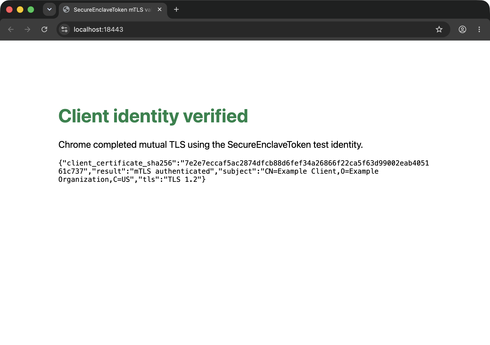

# Chrome mTLS validation

## Result

Validated on **2026-11-21**, using an Apple Silicon Mac on **macOS 26.4.1**,
**Google Chrome 158.0.8127.36**, and a development-signed SecureEnclaveToken app
and extension.

| Check | Result |
| --- | --- |
| Chrome discovers the published P-256 identity | Passed; Example Client appeared in the certificate chooser |
| Chrome completes TLS 1.2 client authentication | Passed |
| Chrome completes TLS 1.3 client authentication | Passed |
| Server verifies the intended certificate | Passed; exact DER SHA-256 matched on both connections |
| Client without a certificate | Rejected during the TLS handshake |

The client key was created by the app in the Secure Enclave. Its CSR was issued
by a temporary local CA, with critical Digital Signature key usage and Client
Authentication EKU. Only the certificate was imported into the token; the
private key was never exported. Chrome used the CryptoTokenKit identity.

The test server required and verified client certificates before accepting an
HTTP request. It also checked that the received certificate exactly matched the
expected fixture. The verified client-certificate SHA-256 was:

```text
f8e7121ce43e6276b916d9d486d4fa18204df2bdc1201b0087e80ed1bf1a9e2e
```



The screenshot was refreshed on **2026-11-23** using a new disposable identity
and a single Chrome tab. That capture verified TLS 1.2 with client certificate
SHA-256 `7e2e7eccaf5ac2874dfcb88d6fef34a26866f22ca5f63d99002eab405161c737`.
The TLS 1.2 / 1.3 results above refer to the original November 21 test.

The disposable key used `none` / `whenUnlocked`, so this run did **not** test
Touch ID prompts, prompt cancellation, or a particular enterprise server. It
used a CA-issued client certificate rather than a self-signed client leaf.
The server's trust in the test CA does not imply system-wide trust.

Chrome ran with a separate temporary profile. The server was bound only to
loopback. Its temporary server certificate was allowed using an exact SPKI
exception in that browser process; this isolates client authentication from
server-certificate trust without installing a CA or changing normal browser
policies. Production clients should validate the server normally.

After validation, the disposable key and identity, local PKI, and temporary
Chrome profile were removed. The existing key and identity were preserved.

## Reproduce locally

Requires a signed app/extension, the installed `setoken` launcher, Chrome,
OpenSSL, and Go. The commands below create a disposable key with **no additional
authentication** for this test. Use a unique key tag and an empty fixture folder.

From the repository root:

```sh
fixtures=$(mktemp -d /tmp/setoken-mtls.XXXXXX)
tag="mtls-validation-$(date +%s)"
./Tests/Manual/prepare-mtls.sh "$fixtures" "$tag"
go build -o "$fixtures/server" ./Tests/Manual/mtls-server.go
"$fixtures/server" "$fixtures"
```

Leave the server running. It listens on `127.0.0.1:18443` for TLS 1.2 and
`127.0.0.1:18444` for TLS 1.3. It requires `ca.pem`, `server.pem`, `server.key`,
and the expected `client.pem` in the fixture folder. Ports must be free.

For older Go installations that emit a Mach-O file without `LC_UUID`, build
with `-ldflags=-linkmode=external`, or use a current Go toolchain.

In another terminal, set `fixtures` to the folder printed by the preparation
script. Launch a dedicated test browser:

```sh
fixtures=/tmp/setoken-mtls.REPLACE_WITH_YOUR_FOLDER
server_spki=$(cat "$fixtures/server-spki.txt")
"/Applications/Google Chrome.app/Contents/MacOS/Google Chrome" \
  --user-data-dir="$fixtures/chrome-profile" \
  --no-first-run --no-default-browser-check --disable-sync --disable-extensions \
  --ignore-certificate-errors-spki-list="$server_spki" \
  https://localhost:18443 https://localhost:18444
```

Select **Example Client** when prompted. Both pages should say **Client identity
verified**. The server should log `VERIFIED` with the appropriate TLS version
and the same `client_certificate_sha256` on both connections. A certificate
chooser alone is not a successful mTLS test.

Confirm that a request without a client certificate fails:

```sh
curl --cacert "$fixtures/ca.pem" https://localhost:18443/
```

Expect a TLS client-certificate error, not the success page.

## Cleanup

Quit only the temporary Chrome instance and stop the local server with Ctrl-C.
Read the tag from the test fixture, then delete only that disposable key:

```sh
setoken destroy "$(cat "$fixtures/key-tag")"
```

Remove the fixture directory after checking its path. It contains the temporary
CA/server private keys and Chrome profile; no Secure Enclave private key is
stored there. If preparation fails after creating a key, `key-tag` identifies
the disposable key that still needs cleanup. Do not remove existing identities
to run this test.
